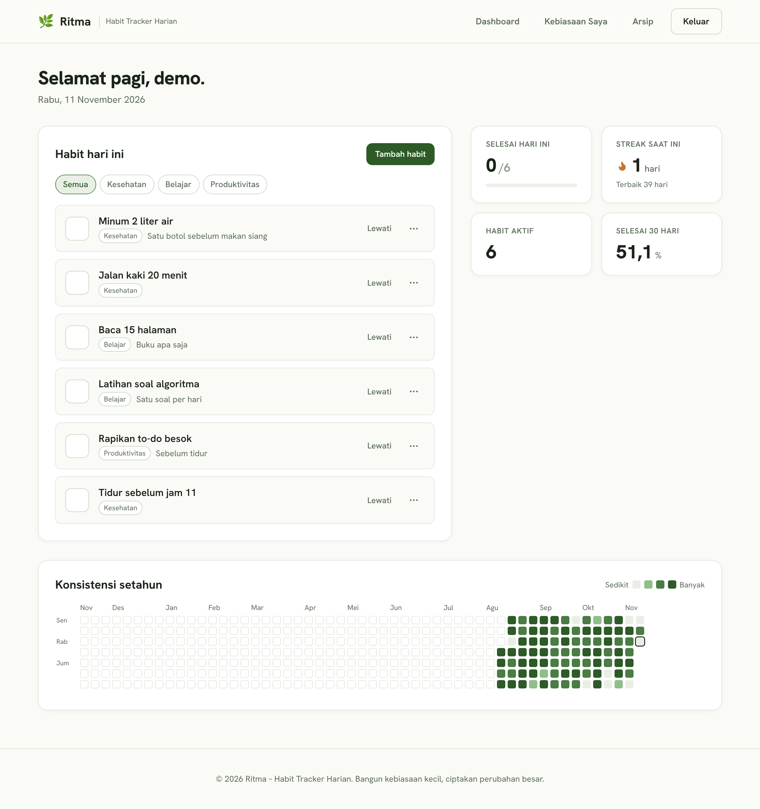

# Ritma, pelacak kebiasaan harian

Flask + PostgreSQL + HTMX. Centang kebiasaan tanpa reload, streak, heatmap setahun, ekspor CSV/JSON.
Penjelasan logika: [LOGIC.md](LOGIC.md).



## Jalankan lokal
```bash
python -m venv .venv && source .venv/bin/activate      # Windows: .venv\Scripts\activate
pip install -r requirements-dev.txt
cp .env.example .env                                    # Windows: copy .env.example .env
export SECRET_KEY=apa-saja-untuk-dev                    # Windows: set SECRET_KEY=...
flask --app run db upgrade
python seed.py                                          # opsional: akun demo@example.com / password123
flask --app run run
pytest                                                  # 54 tes
```

## Deploy gratis: Neon (database) + Render (web)
1. **Neon**: buat akun di neon.tech, buat project, salin *connection string* (`postgresql://...?sslmode=require`).
2. **GitHub**: push folder ini ke repo (public/private).
3. **Render**: New > Blueprint > pilih repo. Render membaca `render.yaml`.
4. Saat diminta, isi `DATABASE_URL` dengan connection string Neon. `SECRET_KEY` dibuat otomatis.
5. Tunggu build selesai, buka URL `*.onrender.com`. Migrasi tabel jalan otomatis saat start.
6. (Opsional) buka Shell/lokal dengan `DATABASE_URL` Neon lalu `python seed.py` untuk akun demo.

Catatan: paket gratis Render tidur setelah 15 menit tidak diakses, jadi request pertama
lambat (~1 menit). Neon juga "scale to zero" saat idle. Buka sekali sebelum presentasi.

## Struktur
`app/routes/habits.py` termasuk halaman Kebiasaan Saya.
`app/services/stats.py` logika murni, `app/services/tracker.py` query + toggle,
`app/routes/` halaman, `app/templates/` tampilan, `tests/` pytest.
